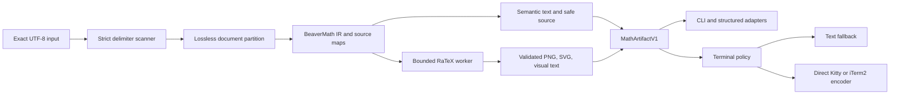

# BeaverMath

Adaptive, source-preserving terminal math rendering for agent harnesses.

> **Status:** private **0.1.0 candidate** (tag `v0.1.0` prepared; repo visibility still **PRIVATE** until re-open). Crates remain unpublished on crates.io (`publish = false`). No Sixel, active probing, or SSH/tmux graphics as supported features.

BeaverMath will turn explicitly delimited LaTeX into readable terminal output without changing the canonical source. A model writes ordinary `$...$`, `$$...$$`, `\(...\)`, or `\[...\]`; the host adapter handles rendering automatically after content completes. No model tool call or prompt-specific rendering instruction is required.

## Product contract

- **Strict by default:** only explicit LaTeX is selected automatically.
- **Source-preserving:** full input, expression slices, UTF-8 byte ranges, and SHA-256 digests remain authoritative across parse, render, failure, replay, and copy paths.
- **Universal text first:** every accepted expression has semantic linear text, safe source display, and alt text before any visual enhancement.
- **Graphics are capability-gated:** v1 targets direct Kitty transfer and direct iTerm2 inline PNG when a trusted, transaction-scoped capability attestation is available.
- **Zero v1 probing:** supported v1 builds perform no terminal capability query and read no terminal reply.
- **Machine-safe:** pipes, files, logs, CI, MCP stdio, structured events, SSH, tmux, GNU screen, and unknown terminals receive text or structured artifacts, never graphics escapes.
- **Repair is opt-in:** ASCII or Unicode reconstruction is a proposal with mapping, confidence, provider, and provenance. It never replaces original content.
- **Local and private:** core performs no telemetry, update check, crash upload, provider request, or hidden network access.

## Planned architecture



RaTeX is the planned primary parser and renderer behind a BeaverMath-owned adapter ([RaTeX](https://github.com/erweixin/RaTeX)). The adapter keeps RaTeX types and error strings out of the public API and permits replacement if the feasibility phase fails its syntax, licensing, confinement, or determinism gates.

OMP is the first harness integration. The initial extension can provide an automatic post-turn derivative preview through documented message events and custom rendering surfaces. True replacement of math spans inside normal assistant content requires a generic presentation-only OMP core renderer hook; the existing documented API covers custom messages and assistant-thinking supplements rather than arbitrary assistant-content span replacement ([OMP extension guide](https://raw.githubusercontent.com/can1357/oh-my-pi/main/docs/extensions.md)). Codex, Claude Code, and OpenCode adapters follow through the same artifact and lifecycle contract.

## CLI (private workspace)

```text
cargo run -p beavermath-cli -- render --format semantic 'The answer is $x^2+y^2=z^2$.'
cargo run -p beavermath-cli -- filter --file doc.txt
cargo run -p beavermath-cli -- doctor
cargo run -p beavermath-cli -- cache stats
cargo run -p beavermath-cli -- repair --consent 'sqrt(x^2+1)'
```

Formats: `auto | semantic | unicode | ascii | png | svg | json | jsonl`.

`beavermath probe` and Sixel remain post-v1. `beavermath mcp` is not enabled until a concrete consumer is identified.

## Workspace layout

```text
crates/beavermath-core      # contracts, scanner, partition, semantic, repair interface
crates/beavermath-render    # RaTeX adapter, PNG/SVG, cache
crates/beavermath-terminal  # text policy, Kitty/iTerm2 typed frames
crates/beavermath-adapter   # neutral events + OMP/Codex/Claude/OpenCode wrappers
crates/beavermath-cli       # beavermath binary
schemas/                    # JSON Schema + fixtures
corpus/                     # positive / negative / hostile fixtures
docs/PHASE_GATES.md         # phase exit-gate ledger
```

## V1 compatibility target

| Destination | Target behavior |
|---|---|
| Direct Kitty or trusted Kitty-compatible WezTerm session | semantic/source plus optional direct-transfer PNG |
| Direct iTerm2 session | semantic/source plus optional inline PNG |
| Apple Terminal, Windows Terminal, GNOME Terminal, unknown terminal | semantic/source plus width-qualified visual text where reliable |
| SSH, tmux, GNU screen, nested multiplexer | text or structured artifact |
| Pipe, file, CI, log, MCP, structured stdout | deterministic text or structured artifact with zero terminal controls |
| Screen-reader preference | semantic/source only |

Terminal graphics protocols are documented by [Kitty](https://sw.kovidgoyal.net/kitty/graphics-protocol/) and [iTerm2](https://iterm2.com/documentation-images.html). WezTerm is the planned reference graphics terminal ([WezTerm `imgcat`](https://wezterm.org/imgcat.html)). Pixel compatibility is tested per emulator and transport. Cross-platform determinism applies to the logical artifact; byte-identical pixel goldens apply to the pinned CI renderer, fonts, and backend.

## Documents

- [Product requirements](tasks/prd-beavermath.md), 38 implementation stories, 100 functional requirements, 20 non-functional requirements, release gates, and compatibility matrices.
- [Engineering roadmap](ROADMAP.md), private foundation through public v1 and separately gated post-v1 terminal expansion.
- [Harness compatibility plan](docs/HARNESS_COMPAT_PLAN.md), live adapters and scaffolds.
- [In-chat presentation (product bar)](docs/INCHAT_PRESENTATION.md), **required:** math readable in the harness chat window for every planned host; sidecar/oneshot are not enough.
- [OMP + OpenCode in-chat scope](docs/OMP_OPENCODE_INCHAT_SCOPE.md), OMP/OpenCode present tracks.
- [Phase exit-gate ledger](docs/PHASE_GATES.md), fixture vs live honesty.
- [Phase 12 publication](docs/PHASE12_PUBLICATION.md), candidate freeze, digests, public flip checklist.
- [Publish roadmap](docs/PUBLISH_ROADMAP.md), ordered R1/R2/R3 stages, sanitize gates, flip sequence.
- [Go-public plan](docs/GO_PUBLIC_PLAN.md), freeze, README target, flip sequence for public 0.1.1.
- [Changelog](CHANGELOG.md) · [Security](SECURITY.md) · [Support](SUPPORT.md) · [Third-party](THIRD_PARTY.md)

## Install (0.1.0)

```bash
# From source
git clone https://github.com/CharlesScottBradley/beavermath.git
cd beavermath
cargo install --path crates/beavermath-cli --locked

# Or download a macOS binary from GitHub Releases and verify SHA-256
# (see docs/RELEASE_DIGESTS.md)
beavermath present --mode semantic <<< 'The answer is $x^2$.'
```

## Privacy and release policy

Public **0.1.0** promotes exact recorded digests ([docs/RELEASE_DIGESTS.md](docs/RELEASE_DIGESTS.md)) without post-approval rebuild of those archives. crates.io, Linux/Windows binaries, and full signatures remain follow-ups. Report security issues per [SECURITY.md](SECURITY.md).

## License

BeaverMath is planned for distribution under either of:

- [MIT License](LICENSE-MIT)
- [Apache License, Version 2.0](LICENSE-APACHE)

The SPDX expression is `MIT OR Apache-2.0`.
