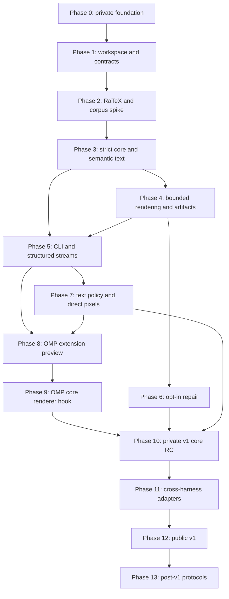

# BeaverMath Engineering Roadmap

**Scope:** private greenfield implementation through public v1.0.0, followed by explicitly separated protocol expansion  
**Source of truth:** [Product Requirements Document](tasks/prd-beavermath.md)  
**Sequence rule:** a phase may begin exploratory work early, but it cannot claim completion until every exit gate and linked PRD story passes  
**Release rule:** public publication promotes the exact approved private candidate without rebuilding

## 1. Outcome

BeaverMath will provide one source-preserving math-rendering core, one stable CLI, terminal-safe text and direct pixel backends, and structured adapters for OMP, Codex, Claude Code, OpenCode, and **Grok Build** (lab first-class).

**Next implementation track:** live harness compatibility (not fixture-only). See [docs/HARNESS_COMPAT_PLAN.md](docs/HARNESS_COMPAT_PLAN.md) for dependencies, mechanisms, H0-H7 phases, and Grok Build G2a/G2b/G2c ladder.

The model writes ordinary explicit LaTeX. The harness or wrapper renders completed expressions automatically. Exact source remains canonical for model context, session history, copying, replay, and audit. Semantic text is available everywhere. Pixel output is optional and confined to a terminal backend with trusted, transaction-scoped capability information.

V1 supports direct Kitty graphics and direct iTerm2 inline PNG only when a host or explicit local option provides trusted capability attestation. V1 performs zero terminal queries. Apple Terminal, SSH, tmux, GNU screen, unknown terminals, pipes, files, logs, CI, MCP stdio, and other machine channels receive safe text or structured artifacts. Active probing, Sixel, and multiplexer/remote graphics remain post-v1 work.

## 2. Delivery principles

1. **Universal artifact first.** Every accepted expression yields immutable exact source, source spans, source digests, semantic text, safe source display, alt text, parse status, and provenance before visual presentation is considered.
2. **Source remains authoritative.** Parsing, layout, repair, and display create derivatives. They never rewrite canonical input.
3. **Strict by default.** Explicit delimiters are automatic. Arbitrary ASCII/Unicode reconstruction requires explicit consent and separate provenance.
4. **Terminal bytes are typed.** Only private validated frame types may write graphics protocol bytes. Model strings and renderer diagnostics cannot become terminal controls.
5. **Machine channels stay machine-safe.** Structured stdout contains structured frames only. Redirected text contains no escape sequences or image payloads.
6. **Evidence controls claims.** Cross-platform logical determinism, pinned-CI artifact determinism, and real-terminal compatibility are separate guarantees.
7. **Private until approved v1.** No public repository, issue, prerelease crate, release candidate, CI artifact, or documentation preview before the publication gate.
8. **Clean cutovers.** Adapters consume the versioned contract. No duplicate schema, legacy alias, or harness-specific core fork survives a phase.

## 3. Planned repository and package layout

This is the target layout. Directories are created only when their phase begins and has a real implementation, fixture, or policy to contain.

```text
beavermath/
├── Cargo.toml                    # workspace and package metadata
├── Cargo.lock                    # committed application lockfile
├── rust-toolchain.toml           # exact release toolchain
├── README.md
├── ROADMAP.md
├── LICENSE-MIT
├── LICENSE-APACHE
├── tasks/
│   └── prd-beavermath.md
├── crates/
│   ├── beavermath-core/          # request/result types, scanner, IR, semantic text
│   ├── beavermath-render/        # bounded RaTeX adapter and artifacts
│   ├── beavermath-terminal/      # text encoder and direct protocol encoders
│   ├── beavermath-adapter/       # neutral lifecycle/event contract
│   └── beavermath-cli/           # executable and machine stream modes
├── adapters/
│   ├── omp/
│   ├── codex/
│   ├── claude-code/
│   └── opencode/
├── schemas/                      # JSON Schema and generated compatibility fixtures
├── corpus/                       # redistributable positive, negative, hostile, a11y fixtures
├── tests/                        # cross-crate and release-contract tests
├── benches/                      # calibrated parser, render, cache benchmarks
├── fuzz/                         # parser, frame, image, and event targets
├── assets/                       # pinned fonts/renderer assets with provenance
├── install/                      # reviewed release installers, added near RC
└── .github/workflows/            # private CI and release workflows
```

### Planned public Rust boundary

```text
RenderRequestV1
OutputContextV1
MathArtifactV1
DocumentPartitionV1
DiagnosticV1
RenderStatusV1
RepairProposalV1
AdapterEventV1
```

The public boundary owns stable enums, fields, diagnostics, and source maps. RaTeX types, terminal crate types, cache internals, and harness SDK types remain private.

### Planned CLI boundary

```text
beavermath render [OPTIONS] [EXPRESSION]
beavermath filter [OPTIONS]
beavermath doctor [OPTIONS]
beavermath cache stats|clear
beavermath repair [OPTIONS]
```

Planned output formats:

```text
auto | semantic | unicode | ascii | png | svg | json | jsonl
```

`beavermath probe` is reserved for an experimental post-v1 build. `beavermath mcp` is added only if Phase 5 identifies a real consumer beyond existing harness adapters and proves strict protocol framing.

## 4. Dependency graph



Phases 4 and 5 may overlap after the Phase 3 logical contract freezes. Phase 6 can run beside terminal work, but it cannot modify strict discovery or source identity. Adapter work begins only after the neutral event contract and OMP lifecycle behavior are proven.

## 5. Phase plan

## Phase 0: Private charter and repository foundation

**Purpose:** establish one private, licensed, evidence-linked source of truth without creating implementation stubs.

**Inputs:** product decisions, terminal/harness research, PRD safety review.

**Work:**

- Create `CharlesScottBradley/beavermath` as a private GitHub repository with `main` as default.
- Add `README.md`, `ROADMAP.md`, `tasks/prd-beavermath.md`, `.gitignore`, `LICENSE-MIT`, and `LICENSE-APACHE`.
- State the pre-v1 privacy boundary and `MIT OR Apache-2.0` licensing.
- Record source-grounded constraints for RaTeX, Kitty, iTerm2, OMP, accessibility, and harness surfaces.
- Keep claims precise: this phase creates a contract and repository, not a working renderer.

**Exit gates:**

- GitHub reports `PRIVATE` visibility and the expected SSH remote.
- Required documents exist, cross-links resolve, Markdown fences balance, and no placeholder or unfinished implementation claim appears.
- PRD contains BM-001 through BM-038, FR-001 through FR-100, and NFR-001 through NFR-020.
- License texts are canonical and the copyright line is project-safe.

**PRD coverage:** BM-001, fixed decisions, repository metadata.

## Phase 1: Rust workspace, schemas, and deterministic toolchain

**Purpose:** create compilable foundations only after the public contract and test shape are explicit.

**Work:**

- Pin an exact stable Rust toolchain and minimum supported Rust version.
- Create the five-crate workspace and CLI package with no placeholder behavior.
- Define the versioned Rust types and JSON Schemas for requests, artifacts, diagnostics, output context, repair proposals, and lifecycle events.
- Establish stable diagnostic codes and exit statuses.
- Generate Rust/TypeScript schema compatibility fixtures from one canonical schema source.
- Configure focused CI for format, lint, unit tests, schema compatibility, license policy, and release package contents.
- Commit `Cargo.lock`; reject floating Git dependencies from the release graph.

**Exit gates:**

- `cargo build --locked --workspace` and `cargo test --locked --workspace` pass on the initial macOS and Linux matrix.
- Schema round trips preserve exact UTF-8, hashes, byte ranges, unknown optional fields, and required-field rejection.
- Human and structured diagnostics use the same stable codes.
- Package metadata names `beavermath`, uses `MIT OR Apache-2.0`, and keeps publication disabled.

**PRD coverage:** BM-002, BM-025, FR-013 through FR-019, FR-071, FR-072, NFR-012, NFR-017.

## Phase 2: Corpus, RaTeX feasibility, and threat-envelope freeze

**Purpose:** prove the primary renderer and support envelope before product architecture depends on them.

**Work:**

- Build a redistributable corpus covering all delimiters, supported TeX, malformed input, Unicode, long expressions, matrices, cases, scripts, roots, sums, integrals, controls, hostile commands, and limit boundaries.
- Spike RaTeX parsing, layout, font loading, SVG/raster paths, cancellation behavior, determinism, and error surfaces.
- Instrument filesystem, network, process, environment, shared-memory, and dynamic-resource access.
- Enumerate the closed supported-command set. Reject file inclusion, packages, URL commands, shell escape, macro definitions, catcode changes, and external assets.
- Audit RaTeX, transitive dependencies, bundled fonts, and asset licenses.
- Calibrate initial input, token, depth, worker, memory, raster, and output limits. Any change from PRD defaults receives a recorded rationale and boundary fixture.
- Choose direct raster output or a validated, resource-free SVG-to-raster path.

**Decision gate:** continue with RaTeX only if the closed command set, deterministic logical output, asset licensing, bounded-worker strategy, and zero-external-I/O contract are viable. Otherwise replace the renderer behind the unchanged BeaverMath contract before Phase 3.

**Exit gates:**

- Every normative expression has expected parse/layout status and stable normalized diagnostics.
- Hostile TeX produces zero unauthorized file, network, process, environment, or shared-memory access.
- Timeout and memory limits are enforceable, not cooperative promises.
- Exact renderer/font versions and checksums are recorded.
- The supported TeX table and unsupported-command behavior are frozen for v1.

**PRD coverage:** BM-007, BM-030, FR-045 through FR-050, FR-078, NFR-003 through NFR-005, NFR-010.

## Phase 3: Strict scanner, lossless IR, source maps, and semantic text

**Purpose:** make the universal artifact correct without graphics, cache, or harness coupling.

**Work:**

- Implement bounded UTF-8 ingestion with exact full-input SHA-256 before parsing.
- Validate host-protected ranges.
- Implement one-pass streaming discovery for `$...$`, `$$...$$`, `\(...\)`, `\[...\]`, and fenced math blocks.
- Freeze delimiter precedence, escape rules, incomplete-span behavior, and chunk-boundary semantics through fixtures.
- Produce a complete ordered partition whose exact slices concatenate to the original input.
- Build BeaverMath-owned math IR and source maps with zero-based half-open UTF-8 byte ranges.
- Implement terminal-safe `source_display` separately from immutable exact source.
- Implement deterministic English semantic text, literal-source fallback, alt status, and optional MathML derivation.
- Implement reversible ASCII and grapheme-safe visual Unicode under explicit width profiles.

**Exit gates:**

- Strict positive, negative, malformed, protected-range, streaming, and chunk-split fixtures pass 100%.
- Documents with no accepted math return byte-identically with `unchanged` status.
- Concatenated spans recover the exact input and all recorded digests match.
- Strict mode selects zero undelimited expressions in the negative corpus.
- Every parsed AST node maps to semantic text or an explicit decorative marker.
- Current pinned Unicode grapheme conformance data passes; unknown width chooses semantic fallback.
- Fuzzing finds no panic, overlap, gap, quadratic rescanning, invalid range, or bound violation.

**PRD coverage:** BM-003 through BM-006, BM-008, BM-009, BM-026 through BM-028, FR-001 through FR-012, FR-073 through FR-081, NFR-001, NFR-015.

## Phase 4: Bounded rendering, immutable artifacts, and cache boundary

**Purpose:** convert the logical artifact into validated derivatives without allowing renderer failures to affect source or semantic output.

**Work:**

- Run RaTeX through the bounded worker selected in Phase 2.
- Produce validated PNG and SVG artifacts with media type, dimensions, byte length, source digest, content digest, renderer version, font identity, and configuration digest.
- Reject external SVG references, scripts, entities, URLs, active content, oversized dimensions, decompression expansion, or mismatched raster lengths.
- Make artifact values immutable and content-addressed.
- Implement process-local memory cache.
- Implement opt-in persistent cache with owner-only permissions, atomic no-follow writes, per-cache secret, keyed filenames, 256 MiB/30-day default limits, and explicit clear/no-cache controls.
- Store no raw source, surrounding prompt, credentials, terminal response, user identity, or harness context in persistent cache.

**Exit gates:**

- Parse or render failure preserves surrounding text, exact source, hash, semantic text, and stable diagnostic.
- Explicit PNG/SVG requests are invariant under terminal environment changes.
- Pinned-CI artifact fixtures are byte-stable across 100 repeated runs.
- Boundary-plus-one and overflow cases fail before allocation or artifact publication.
- Cache race, symlink, permission, corruption, eviction, secret rotation, and concurrent-writer tests pass.
- `--no-cache` performs no persistent read or write.

**PRD coverage:** BM-010, BM-018, BM-029 through BM-031, FR-020 through FR-028, FR-046 through FR-050, FR-082 through FR-086, NFR-002, NFR-005, NFR-016.

## Phase 5: CLI, machine streams, cancellation, and artifact APIs

**Purpose:** make the core usable and composable before terminal pixels or harness-specific presentation.

**Work:**

- Implement `render`, `filter`, `doctor`, `cache`, and `repair` command boundaries.
- Implement `semantic`, `unicode`, `ascii`, `png`, `svg`, `json`, and `jsonl` formats.
- Keep content stdout, sanitized diagnostics stderr, and exit statuses stable.
- Implement JSON/JSONL request/result framing, backpressure, cancellation, broken-pipe behavior, and bounded excerpts.
- Keep machine streams independent of terminal width, locale, `$TERM`, graphics variables, and accessibility UI state.
- Add `beavermath mcp` only if a concrete consumer needs it. If added, use framed protocol stdout and a separate diagnostic channel.
- Publish library examples for direct expression, whole-document filtering, explicit artifact creation, and source-copy retrieval.

**Exit gates:**

- Pipe, file, log, CI, JSON, JSONL, and any MCP captures contain zero ESC, C1, OSC, DCS, APC, image payload, cursor rewrite, or private-use image placeholder.
- Whole-document filtering changes only accepted math spans and retains exact-source fields for each replacement.
- Broken pipe stops without retry, duplicate output, or another sink.
- Cancellation reaps active work and publishes no partial artifact.
- CLI fixtures pass on macOS, Linux, and Windows with LF-defined logical records.

**PRD coverage:** BM-011, BM-020, BM-025, BM-027, FR-059 through FR-070, FR-071, FR-080, FR-095 through FR-097, NFR-006, NFR-013.

## Phase 6: Opt-in ASCII/Unicode repair proposals

**Purpose:** add ambiguous-source assistance without weakening strict discovery or source authority.

**Work:**

- Freeze `RepairProviderV1` and `RepairProposalV1`.
- Require explicit per-request consent or a host policy grant.
- Preserve original source and hash before provider invocation.
- Record inferred TeX, byte mapping, inserted tokens, confidence, provider identity, model/version if applicable, deterministic parameters, and provenance.
- Keep BeaverMath core offline. Host adapters own provider credentials and network policy.
- Separate `repair suggest` from `repair render`; neither edits the canonical transcript.
- Build an adjudicated corpus for ambiguous ASCII/Unicode, prose negatives, units, code, tables, currency, and malformed notation.

**Exit gates:**

- Strict mode never invokes repair and selects zero undelimited negative-corpus items.
- Exact original recovery is 100% across all accepted, rejected, timeout, provider-error, and rendered-proposal paths.
- Selected repair precision reaches at least 95% on the frozen adjudicated corpus before automatic presentation is allowed.
- Every inferred token maps to original bytes or is marked inserted with provenance.
- Provider output cannot inject terminal controls, resource commands, cache paths, or canonical content changes.

**PRD coverage:** BM-019, FR-087 through FR-089, fixed decision 8, NFR-009.

## Phase 7: Terminal-safe text policy and direct pixel encoders

**Purpose:** add pixels as a bounded side effect after the universal artifact and safe text paths are complete.

### Phase 7A: Typed text sink and passive decision engine

- Implement private `ValidatedTextFrame` and `ValidatedGraphicsFrame` constructors.
- Visibly escape untrusted C0/C1 controls, ESC, DEL, control strings, and bidi overrides. Writer-owned LF is the only semantic-mode control.
- Implement closed `OutputContextV1` enums for output kind, transport, accessibility preference, trusted capability, and decision reason.
- Require a direct TTY plus trusted transaction-scoped capability attestation or explicit local trusted-capability option for v1 pixels.
- Let environment values deny or nominate candidates only. Standalone `auto` without trusted capability stays text-only.
- Emit zero terminal queries in every supported v1 mode.

**Gate 7A:** an independent UTF-8 and ECMA-48 validator finds no unintended terminal action in the complete adversarial corpus, at every input chunk boundary.

### Phase 7B: Direct Kitty encoder

- Encode PNG through Kitty direct transfer `t=d` only.
- Use random owned image/placement IDs, bounded 4096-byte base64 chunks, and ID-specific cleanup.
- Make file, temporary-file, shared-memory, terminal-assigned ID, arbitrary action, and delete-all fields unrepresentable.
- Prebuild and independently parse each bounded frame before the first protocol byte is written.

**Gate 7B:** exact byte fixtures, short-write injection, cancellation, owned cleanup, size boundaries, and current direct Kitty/WezTerm tests pass.

### Phase 7C: Direct iTerm2 encoder

- Encode bounded PNG with OSC 1337 `inline=1`, fixed trusted metadata, no user-controlled filename, and ST termination.
- Treat the backend as append-only. Do not claim deletion or transient repaint.
- Disable file download, multipart arbitrary files, URLs, and model-controlled dimensions or names.

**Gate 7C:** exact byte fixtures, short-write termination, payload limits, and current direct iTerm2 tests pass without any download side effect.

### V1 terminal matrix

| Path | V1 behavior |
|---|---|
| Direct TTY plus trusted Kitty attestation | semantic/source, then optional Kitty PNG |
| Direct TTY plus trusted iTerm2 attestation | semantic/source, then optional inline PNG |
| WezTerm with trusted Kitty-compatible attestation | semantic/source, then optional Kitty PNG |
| Apple Terminal or unknown emulator | semantic/source and optional visual Unicode |
| SSH, tmux, GNU screen, nested multiplexer | text or structured artifact |
| pipe, file, CI, log, MCP, structured stdout | deterministic text or artifact, zero terminal controls |
| accessibility preference | semantic/source only |

**Phase exit gates:**

- Universal artifact exists before any capability decision or graphics frame.
- A named graphics option without trusted capability does not emit pixels.
- Supported v1 modes emit zero terminal queries and read no terminal replies.
- Model-supplied OSC, CSI, DCS, APC, clipboard, title, link, query, file, path, bidi, and nested-wrapper vectors cause zero side effects.
- Visual failure never removes, alters, duplicates, or reorders semantic/source output.
- VoiceOver, NVDA, Orca, braille, copy, light/dark/high-contrast, and grapheme fixtures pass.

**PRD coverage:** BM-012, BM-014, BM-015, BM-017, FR-029 through FR-044, FR-051 through FR-058, NFR-007, NFR-008.

## Phase 8: OMP extension-only automatic preview

**Purpose:** validate model-invisible rendering and lifecycle behavior without an OMP core fork.

OMP's documented extension API exposes message lifecycle events, custom message rendering, widgets, and assistant-thinking supplemental rendering. It does not document arbitrary replacement of spans inside a normal assistant text block, so this phase uses a derivative post-turn preview and keeps the limitation explicit ([OMP extension guide](https://raw.githubusercontent.com/can1357/oh-my-pi/main/docs/extensions.md)).

**Work:**

- Build a typed RPC/SDK wrapper around the neutral adapter contract.
- Observe `message_start`, `message_update`, `message_end`, turn, branch, resume, switch, and shutdown events.
- Show source while streaming. Parse and render only completed assistant content.
- Associate custom preview messages or widgets with message ID, revision, content digest, expression ID, and artifact digest.
- Reconstruct derivative state from session entries where appropriate without storing terminal frames or raw cache paths.
- Respect headless, RPC, ACP, and no-UI modes through artifacts or semantic output.

**Exit gates:**

- Model prompts and tool lists contain no BeaverMath instruction or required render call.
- Normal assistant/session content remains byte-identical.
- Resume, replay, branch, replacement, deletion, duplicate update, out-of-order event, reconnect, and cancellation fixtures create no stale or duplicate preview.
- Extension-only mode clearly presents the preview as supplemental, not true inline replacement.
- OMP end-to-end tests pass in interactive and headless/RPC paths.

**PRD coverage:** BM-020, BM-021, BM-032, FR-090, FR-095, FR-096.

## Phase 9: Generic OMP assistant-content renderer hook

**Purpose:** enable true inline presentation while preserving immutable provider/session content.

**Work:**

- Design a generic `registerAssistantContentRenderer`-class hook for OMP core.
- Pass immutable message content, message ID/revision, content index, viewport, theme, accessibility preference, protected ranges, and async rerender callback.
- Keep source visible during streaming. Allow completed spans to receive presentation overlays.
- Guarantee copy, resume, branch, compaction, model context, export, and session APIs retain exact source.
- Ensure multiple renderers compose deterministically and cannot mutate messages.
- Add upstream-quality tests, extension documentation, failure isolation, cancellation, and performance measurements.
- Decide upstream contribution, maintained patch, or external wrapper based on OMP maintainer feedback and long-term maintenance cost.

**Exit gates:**

- Inline display passes the same source, lifecycle, accessibility, and security fixtures as the extension preview.
- Removing or disabling the renderer restores the original transcript without migration.
- Renderer failure falls back to source text and does not affect agent execution.
- The hook remains useful outside BeaverMath and introduces no harness-specific schema into core messages.

**PRD coverage:** BM-022, FR-091.

## Phase 10: Private v1 core release candidate and API freeze

**Purpose:** freeze the core, CLI, direct terminal support, OMP integration, and repair contract before adding the remaining harness adapters.

**Work:**

- Freeze Rust API, schemas, diagnostics, CLI syntax, exit statuses, cache format, direct terminal protocol grammar, and OMP lifecycle behavior.
- Run the full strict, semantic, artifact, repair, terminal, accessibility, cache, fuzz, performance, and portability matrix.
- Generate target archives for `aarch64-apple-darwin`, `x86_64-apple-darwin`, `x86_64-unknown-linux-gnu`, `aarch64-unknown-linux-gnu`, and `x86_64-pc-windows-msvc`; remove any target whose renderer confinement, smoke, or reproducibility evidence fails.
- Produce per-target checksums, SBOM, provenance, signatures/attestations, third-party notices, and license inventory.
- Add private install scripts only after they verify identity and digest, install user-locally and atomically, avoid `sudo`, and leave shell profiles unchanged without consent.
- Record baseline performance and memory numbers on named reference hosts.

**Exit gates:**

- Every blocking PRD metric that applies to core, CLI, OMP, and direct terminal support passes.
- Same-target independent rebuilds produce matching unpacked payloads.
- Clean-machine install and smoke fixtures pass for every advertised target.
- No High/Critical unmitigated advisory, unknown license, unaudited font, or floating release input remains.
- Full private history, archives, SBOMs, logs, and documentation pass secret/private-content scans.
- Candidate commit and artifact digests become immutable inputs to later adapter and publication gates.

**PRD coverage:** BM-025, BM-029 through BM-031, FR-098, FR-099, NFR-010, NFR-011, NFR-018 through NFR-020.

## Phase 11: Codex, Claude Code, and OpenCode adapters

**Purpose:** prove that the neutral contract works across harnesses without changing core semantics.

### Phase 11A: Codex

- Integrate documented noninteractive or app-server structured events.
- Add one-shot filtering that preserves producer exit status and stdout/stderr separation.
- Use sidecar preview, artifact reference, or semantic text when no native content-renderer hook exists.

**Gate:** lifecycle, source, cancellation, redirected-output, and headless fixtures match OMP behavior.

### Phase 11B: Claude Code

- Integrate documented hooks for native text/artifact behavior.
- Add an optional rich wrapper that owns the TTY and requires trusted capability input for pixels.
- Keep hook and machine stdout free of terminal escapes.

**Gate:** hook failure leaves the Claude session usable; exact source and exit behavior are preserved.

### Phase 11C: OpenCode

- Integrate documented server, SSE, CLI, or plugin events.
- Handle reconnect, replay, duplicate, reorder, replacement, deletion, and one-shot modes.
- Keep canonical messages immutable.

**Gate:** all adapter-neutral event fixtures pass without harness-specific core branches.

**Phase exit gates:**

- OMP, Codex, Claude Code, and OpenCode consume the same schema version and diagnostic registry.
- Each adapter has one documented native path and one safe fallback.
- Screen scraping appears nowhere in the supported implementation.
- Machine stdout byte scans remain clean for every harness mode.
- Adapter-specific dependencies do not enter the core or CLI dependency graph.

**PRD coverage:** BM-023, BM-033 through BM-038, FR-092 through FR-096.

## Phase 12: Public v1.0.0 publication

**Purpose:** publish the reviewed private candidate and adapters without introducing a new build or unreviewed content.

**Work:**

- Freeze release notes, changelog, support matrix, privacy policy, security reporting route, third-party notices, installation and verification instructions, and known limitations.
- Confirm direct Kitty and iTerm2 are the only v1 pixel claims; list all fallback paths explicitly.
- Approve the exact private candidate commit, crates, target archives, checksums, SBOMs, provenance, signatures/attestations, installers, and documentation digests.
- Change repository visibility, publish the crate/package, create the tag and release, and publish documentation in one controlled sequence.
- Promote prebuilt approved artifacts. Do not rebuild after approval.
- Configure OIDC/trusted publication after the first registry release where registry policy requires a bootstrap token.
- Run post-publication installation and smoke checks from public endpoints.

**Publication blockers:**

- Any digest differs from the approved candidate.
- Any release target lacks reproducibility, confinement, signature/attestation, SBOM, install, or smoke evidence.
- Any private artifact, issue, secret, model content, cache content, or unreleased design leaks into public payloads.
- Any terminal, accessibility, source-identity, adapter, or machine-channel matrix cell fails.
- The public README overstates Sixel, SSH/tmux graphics, probing, Apple Terminal pixels, repair authority, or cross-emulator determinism.

**Exit gates:**

- GitHub, registry, documentation, source tag, checksums, SBOMs, provenance, and archives identify the same commit and version.
- Public clean-machine installs pass exact-source, semantic render, PNG/SVG artifact, direct terminal where supported, and redirected-output smoke fixtures.
- Security reporting works privately and supported-version policy is published.
- V1 artifacts remain reproducible from the tagged source and pinned toolchain.

**PRD coverage:** BM-024, FR-098 through FR-100, all blocking success metrics.

## Phase 13: Post-v1 terminal and semantic expansion

This phase does not delay v1 and carries no v1 compatibility claim.

### 13A: Experimental safe probing

- Add explicit `--probe=safe` only to an experimental build.
- Require a named allowlisted candidate, foreground controlling TTY, same input/output terminal, and exclusive input lease.
- Preserve unrelated input and restore exact termios state on success, timeout, malformed response, signal, panic, and cancellation.
- Use 250 ms direct, 1 s SSH/tmux, and 2 s absolute maximum deadlines.
- Keep a named graphics preference insufficient to force pixels.

### 13B: Sixel

- Implement a bounded response parser and monochrome append-only encoder.
- Reject DA1 false positives, palette mutation, unbounded repeat expansion, oversized dimensions, and unterminated DCS.
- Preserve cursor/rendition state and test current real Sixel terminals.

### 13C: SSH and tmux graphics

- Require end-terminal confirmation, direct Kitty transfer, and an exact one-layer tmux wrapper.
- Fall back on hidden panes, stripped passthrough, reattachment, stale identity, nested multiplexer, or timeout.
- Keep GNU screen and unknown nesting text-only until separately proven.

### 13D: Repair and accessibility locales

- Add additional host-owned repair providers only after provider-specific quality, privacy, and reproducibility reviews.
- Add locales through frozen semantic profiles and native-speaker review.
- Explore structured MathML navigation in hosts that expose an accessibility tree.

**PRD coverage:** BM-013, BM-016, post-v1 open decisions.

## 6. Cross-phase verification system

### 6.1 Test layers

| Layer | Contract defended |
|---|---|
| Unit | scanner states, source maps, semantic nodes, diagnostics, limits, encoders |
| Property | exact partition reconstruction, chunk invariance, checked bounds, decision completeness |
| Golden | semantic text, ASCII, visual Unicode, JSON, PNG/SVG in pinned CI, protocol bytes |
| Fuzz | UTF-8 ingestion, delimiters, protected ranges, RaTeX adapter, SVG/image metadata, terminal frames, adapter events |
| PTY adversarial | terminal controls, short writes, state restoration, clipboard/title/link/file/query absence |
| Real terminal | direct Kitty, WezTerm, iTerm2, Apple Terminal fallback, post-v1 Sixel |
| Accessibility | VoiceOver, NVDA speech, NVDA braille, Orca, copy and reading order |
| Transport | pipe, file, CI, SSH fallback, tmux fallback, screen fallback, machine stdout |
| Harness E2E | OMP, Codex, Claude Code, OpenCode lifecycle and fallback |
| Release | clean install, checksums, SBOM, provenance, signatures, reproducibility, public smoke |

### 6.2 Critical invariants

The following failures block every later phase that depends on them:

1. Exact input or expression source differs by one byte.
2. An expression or artifact digest does not match immutable bytes.
3. Strict mode selects undelimited prose, currency, code, URL, or protected content.
4. Semantic and alt text are both absent, or semantic output invents unsupported meaning.
5. A visual failure changes, suppresses, duplicates, or reorders universal output.
6. Plain, redirected, log, CI, structured, or unsupported-terminal output contains a terminal control.
7. Untrusted content reaches a terminal protocol control field.
8. Renderer work accesses an unauthorized resource or exceeds an enforceable bound.
9. Persistent cache stores raw source/context or violates owner-only atomic-write policy.
10. An adapter mutates canonical content or mishandles replay/revision/deletion.
11. A release claim lacks a passing matrix row on current software.
12. A public artifact differs from the approved private candidate.

### 6.3 Reference compatibility matrix

Required before public v1:

- macOS: direct Kitty-compatible terminal, WezTerm reference path, direct iTerm2, Apple Terminal text/VoiceOver fallback, pipe/file/CI.
- Linux: direct Kitty, WezTerm where available, GNOME Terminal text/Orca fallback, pipe/file/CI.
- Windows: Windows Terminal text/NVDA/braille fallback, pipe/file/CI, core artifact generation.
- Transports: SSH with and without PTY as text fallback; tmux and GNU screen as text fallback.
- Harnesses: OMP interactive and RPC/headless; Codex structured and one-shot; Claude hook and wrapper; OpenCode server/plugin and one-shot.

A target or integration leaves the advertised matrix rather than receiving a release waiver when confinement, source identity, accessibility, machine-channel purity, or reproducibility cannot be demonstrated.

## 7. Risk register

| Risk | Consequence | Mitigation and decision gate |
|---|---|---|
| RaTeX lacks required syntax or deterministic assets | core rewrite or unstable artifacts | Phase 2 closed support envelope; adapter isolation permits renderer replacement |
| Renderer can access filesystem/network or hang | data disclosure or denial of service | closed commands, bounded worker, syscall instrumentation; no release without enforceable confinement |
| Terminal protocol injection | clipboard/file/window/transcript compromise | typed frames, no raw strings, independent parser, adversarial PTY tests |
| Capability spoofing | unsafe pixels in wrong terminal | trusted transaction attestation only; zero v1 queries; text fallback |
| Pixel partial write | terminal parser left in control string | prebuilt bounded frames, fixed termination, short-write tests; semantic output already complete |
| Width/grapheme mismatch | corrupt visual math or copy behavior | pinned grapheme data, explicit width profiles, semantic fallback |
| Repair changes mathematical meaning | incorrect answer presented as source | opt-in derivative, exact source, mapping, confidence, provenance, separate quality gate |
| OMP lacks inline assistant renderer | supplemental rather than inline preview | extension-only proof, then generic core hook proposal |
| Other harnesses lack rich hooks | inconsistent UX | neutral artifacts plus sidecar/post-turn fallback; no screen scraping |
| Cache exposes formulas | sensitive-content disclosure | off by default, no raw source/context, per-cache keyed names, owner-only atomic storage |
| Private history leaks at publication | unreleased data or secret disclosure | full-history and payload scans, approved allowlist, coordinated publication |
| Rebuild differs from approved RC | supply-chain substitution | promote exact candidate digests without rebuilding |

## 8. Deferred by design

The following work remains outside public v1 unless this roadmap is explicitly revised with new threat-model and compatibility evidence:

- Active terminal probing.
- Sixel, ReGIS, Kitty file/shared-memory transfer, iTerm2 download/multipart, or arbitrary terminal graphics extensions.
- SSH or multiplexer pixel passthrough.
- GNU screen or nested-multiplexer graphics.
- Full TeX/LaTeX compilation, packages, user macros, file inclusion, external fonts, URLs, bibliography, or shell escape.
- PDF generation.
- Full-screen interactive equation viewer or editor.
- Remote cache, cloud account, telemetry, analytics, crash upload, or update check.
- Default model-assisted reconstruction of undelimited text.
- Pixel-byte determinism across unrelated terminals, GPUs, fonts, and operating systems.

## 9. Evidence sources

- [RaTeX](https://github.com/erweixin/RaTeX)
- [Kitty graphics protocol](https://sw.kovidgoyal.net/kitty/graphics-protocol/)
- [iTerm2 inline images](https://iterm2.com/documentation-images.html)
- [WezTerm `imgcat`](https://wezterm.org/imgcat.html)
- [ratatui-image](https://github.com/ratatui/ratatui-image)
- [ECMA-48](https://ecma-international.org/publications-and-standards/standards/ecma-48/)
- [WCAG 2.2](https://www.w3.org/TR/WCAG22/)
- [WCAG2ICT terminal guidance](https://www.w3.org/TR/wcag2ict-22/#text-command-line-terminal-applications-and-interfaces)
- [MathML 4](https://w3c.github.io/mathml/)
- [OMP extension guide](https://raw.githubusercontent.com/can1357/oh-my-pi/main/docs/extensions.md)
- [Codex noninteractive mode](https://developers.openai.com/codex/noninteractive)
- [Claude Code hooks](https://code.claude.com/docs/en/hooks)
- [OpenCode CLI](https://opencode.ai/docs/cli/)
- [OpenCode plugins](https://opencode.ai/docs/plugins/)
